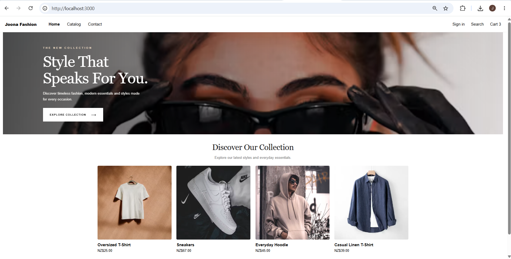
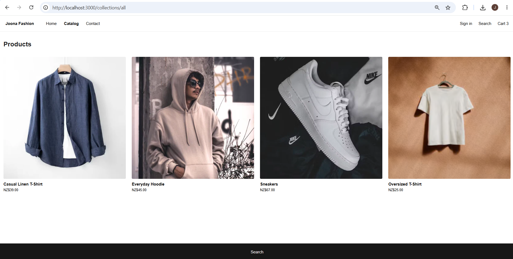
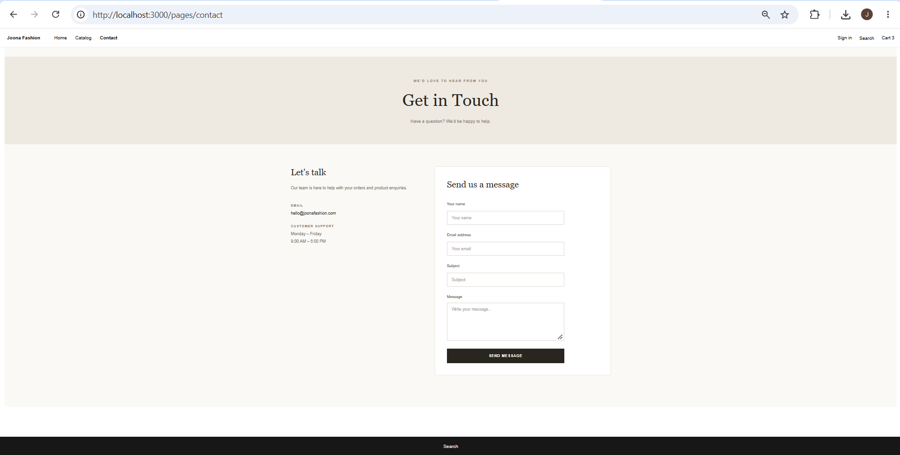

# Joona Fashion – Shopify Headless Ecommerce Store

A modern, responsive fashion ecommerce storefront built using **Shopify Hydrogen, React and CSS**. This project demonstrates how to build a customised Shopify storefront using React while managing products and store content through Shopify.

## Project Overview

Joona Fashion is a fashion ecommerce storefront designed to provide a clean, minimal and modern shopping experience.

The project uses Shopify as the ecommerce backend and Hydrogen with React for the frontend.

## Application Screenshots

### Homepage



### Product Catalogue



### Contact Page



## Technologies Used

- React
- Shopify Hydrogen
- Shopify Storefront API
- JavaScript (ES6+)
- CSS
- React Router
- Shopify CLI

## Features Implemented

### 1. Homepage

- Customised ecommerce homepage.
- Hero section with promotional content.
- Recommended products section.
- Responsive product grid.
- Custom styling for a modern fashion storefront.

### 2. Product Catalogue

- Displays products managed through Shopify Admin.
- Uses Shopify collection data.
- Displays product images, titles and prices.
- Navigation to product details.

### 3. Navigation

- Home
- Catalog
- Contact

### 4. Custom Contact Page

Created a reusable React component (`Contacts.jsx`) for the Contact page.

Features include:

- Customer name field.
- Email address field.
- Subject field.
- Message field.
- Required-field validation.
- Submission feedback.
- Responsive layout.

The Contact component is integrated into the existing dynamic Shopify page route (`pages.$handle.jsx`). When the page handle is `contact`, the custom React component is rendered. Other Shopify pages continue to display their Shopify-managed content.

**Note:** The Contact form currently demonstrates frontend form handling only. Backend submission, database storage and email notifications are not yet connected.

### 5. Responsive Design

- Custom CSS styling.
- Desktop and mobile layouts.
- Responsive product cards.
- Consistent colour palette and typography.

## Project Structure

```text
react-shopify/
├── app/
│   ├── components/
│   │   └── Contacts.jsx
│   ├── routes/
│   │   ├── _index.jsx
│   │   ├── collections.all.jsx
│   │   └── pages.$handle.jsx
│   └── styles/
│       └── app.css
├── public/
├── screenshots/
│   ├── home.png
│   ├── catalog.png
│   └── contact.png
├── .gitignore
├── package.json
└── README.md
```

*This is a simplified overview of the main project files.*

## Project Setup

### Prerequisites

Make sure you have the following installed:

- Node.js (LTS version recommended)
- npm
- Git
- Shopify development store
- Visual Studio Code (recommended)

### Step 1: Install Shopify CLI

```bash
npm install -g @shopify/cli@latest
```

### Step 2: Create a Hydrogen Project

If you want to create a new Hydrogen project from scratch:

```bash
npm create @shopify/hydrogen@latest -- --quickstart
```

Follow the prompts to create your project.

**Note:** You do not need to create a new project if you are cloning this existing repository.

## Running the Project Locally

Follow these steps to run Joona Fashion on your local machine.

### Step 1: Clone the Repository

```bash
git clone https://github.com/JoonaGeorge/react-shopify.git
```

### Step 2: Navigate to the Project Folder

```bash
cd react-shopify
```

### Step 3: Install Dependencies

```bash
npm install
```

### Step 4: Connect Your Shopify Store

This project uses Shopify Hydrogen and the Shopify Storefront API.

Run the following command from your Hydrogen project directory:

```bash
npx shopify hydrogen link
```

Follow the authentication prompts and select your Shopify development store.

### Step 5: Retrieve Environment Variables

```bash
npx shopify hydrogen env pull
```

This retrieves the environment configuration required to connect your storefront to Shopify.

**Security:** Never commit `.env` files, access tokens or authentication credentials to GitHub. Anyone running this project will need to configure their own Shopify store connection.

### Step 6: Start the Development Server

```bash
npm run dev
```

Open the application in your browser:

http://localhost:3000/

## Shopify Store Configuration

### 1. Update Store Details

In Shopify Admin:

1. Open Settings.
2. Select General.
3. Find Store details.
4. Update the store name to **Joona Fashion**.
5. Save your changes.

### 2. Add Products

In Shopify Admin:

1. Navigate to Products → All products.
2. Add your products.
3. Upload product images.
4. Add product titles, descriptions and prices.
5. Set the product status to Active.
6. Make products available to the relevant sales channel.

The Hydrogen storefront retrieves product information from Shopify.

### 3. Create Shopify Pages

Navigate to Content → Pages.

Create and publish a Contact page with:

- **Title:** Contact
- **Handle:** contact

The page is accessible through:

```text
/pages/contact
```

## Custom Contact Component Integration

The Contact component is located at:

```text
app/
├── components/
│   └── Contacts.jsx
├── routes/
│   └── pages.$handle.jsx
└── styles/
    └── app.css
```

Import the component into `pages.$handle.jsx`:

```jsx
import {Contacts} from '~/components/Contacts';
```

Inside the existing page component, check the Shopify page handle:

```jsx
export default function Page() {
  const {page} = useLoaderData();

  if (page.handle === 'contact') {
    return <Contacts />;
  }

  return (
    <div className="page">
      <header>
        <h1>{page.title}</h1>
      </header>
      <main dangerouslySetInnerHTML={{__html: page.body}} />
    </div>
  );
}
```

This allows the storefront to display a custom React Contact page while retaining Shopify's dynamic page functionality for other pages.

## Styling

Custom styles are maintained in:

```text
app/styles/app.css
```

The stylesheet includes:

- Homepage.
- Navigation bar.
- Product cards and product grids.
- Contact page.
- Form fields and buttons.
- Responsive layouts.

## Available Commands

| Command | Description |
|---|---|
| `npm install` | Installs project dependencies |
| `npm run dev` | Starts the development server |
| `npm run build` | Creates a production build |
| `npm run preview` | Previews the production build, if configured |

## Future Improvements

- Connect the Contact form to a backend API.
- Send customer enquiries through an email service.
- Implement database storage for customer enquiries.
- Improve product filtering and search.
- Add automated component and end-to-end tests.
- Improve accessibility and performance.
- Deploy the storefront using Shopify Oxygen.

## Project Objective

This project is part of my practical learning journey in React and Shopify Hydrogen. It demonstrates my ability to build reusable frontend components, integrate Shopify storefront data, implement responsive layouts and customise an ecommerce user experience using modern frontend technologies.

## Author

**Joona George**

GitHub: [JoonaGeorge](https://github.com/JoonaGeorge)

Project Repository: [react-shopify](https://github.com/JoonaGeorge/react-shopify)
